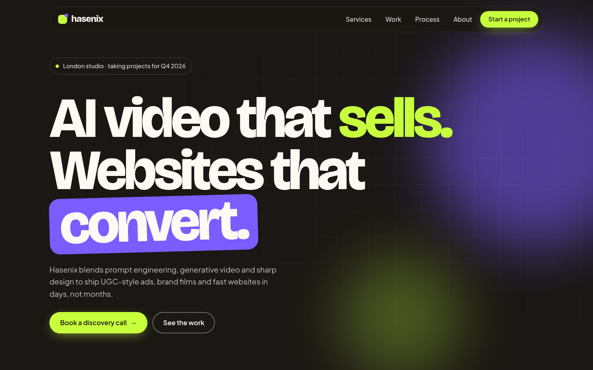
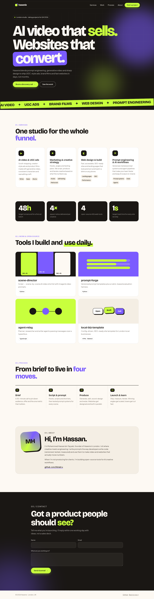
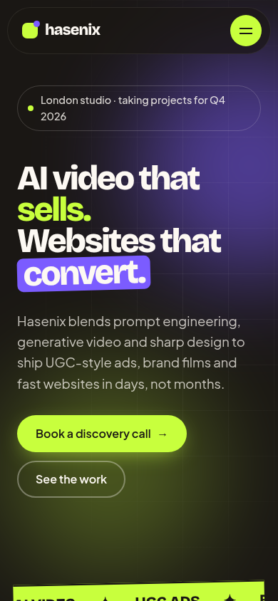

<div align="center">

# hasenix-portfolio

**A sleek, animated single-page portfolio for Hasenix, a London studio for AI video, UGC ads, marketing and web design.**

[](https://github.com/hbtabi/hasenix-portfolio/actions/workflows/pages.yml)


[](LICENSE)

</div>

## 📸 Screenshot

<p align="center"></p>

<details>
<summary>Full page and mobile</summary>
<p align="center">
  
  
</p>
</details>

**Live demo:** once Pages is enabled it is served at `https://hbtabi.github.io/hasenix-portfolio/`

## ✨ Features

- **On-brand design system** in CSS custom properties: ink `#1a1714`, cream `#fdf9f3`, lime `#c8ff3d`, purple `#7b5cff`; type in **Bricolage Grotesque** (display) + **Plus Jakarta Sans** (body)
- **Motion**: staggered scroll reveals, rotating hero word, infinite marquee, floating gradient orbs, count-up stats, 3D card tilt, blend-mode cursor
- **Responsive**: fluid `clamp()` type, 4 → 2 → 1 column grids, animated mobile menu
- **Accessible**: skip link, semantic landmarks, `aria-expanded` menu, visible focus rings, full `prefers-reduced-motion` support
- **SEO-ready**: meta description, Open Graph, `schema.org/ProfessionalService` JSON-LD, single `h1`
- **No build step, no framework**: one HTML file, one CSS file, one JS file (~2 KB JS and ~5 KB CSS gzipped)
- **Contact form without a backend**: validates, then opens a pre-filled email (works on GitHub Pages)
- **Quality checks**: `npm test` verifies assets, anchors, duplicate ids, meta tags, alt text and `rel="noopener"`

## 🚀 Quick start

```bash
git clone https://github.com/hbtabi/hasenix-portfolio.git
cd hasenix-portfolio
npm run dev          # zero-dependency static server → http://localhost:5173
npm test             # static checks (no install needed)
```

Regenerate the screenshots (uses your local Chrome via `playwright-core`):

```bash
npm install
npm run screenshot   # → docs/screenshot.png, docs/screenshot-hero.png, docs/screenshot-mobile.png
```

## 🌍 Deploy to GitHub Pages

1. Push to `main`.
2. In **Settings → Pages**, set **Source** to **GitHub Actions**.
3. The included workflow (`.github/workflows/pages.yml`) runs the checks and deploys.

Any static host works too (Netlify, Vercel, Cloudflare Pages): just upload the repo root.

## 🛠️ Customise

| What | Where |
|---|---|
| Colours, radius, fonts | `:root` in `assets/css/style.css` |
| Rotating hero words | `words` array in `assets/js/main.js` |
| Contact email | `CONTACT_EMAIL` in `assets/js/main.js` |
| Sections and copy | `index.html` |

## 🗂️ Project structure

```
hasenix-portfolio/
├── index.html              # the whole page
├── assets/
│   ├── css/style.css       # design tokens, layout, animations, responsive rules
│   ├── js/main.js          # reveals, counters, nav, tilt, cursor, contact form
│   └── img/favicon.svg
├── scripts/
│   ├── serve.mjs           # zero-dep dev server
│   ├── check.mjs           # static quality checks (npm test)
│   └── screenshot.mjs      # headless Chrome screenshots
├── docs/                   # screenshots
└── .github/workflows/pages.yml
```

## 🛣️ Roadmap

- [ ] Case-study pages with embedded video reels
- [ ] Dark/light theme toggle
- [ ] Self-hosted, subset fonts for even faster first paint
- [ ] Formspree / Cloudflare Worker contact backend option
- [ ] Lighthouse CI budget in the workflow

## 📄 License

[MIT](LICENSE) © 2026 Mohammed Hassan bin Tayyeb
